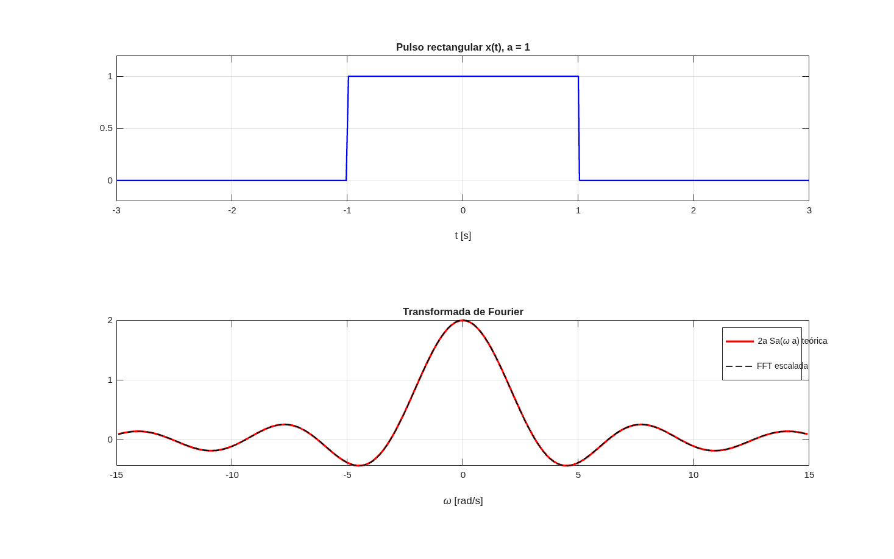
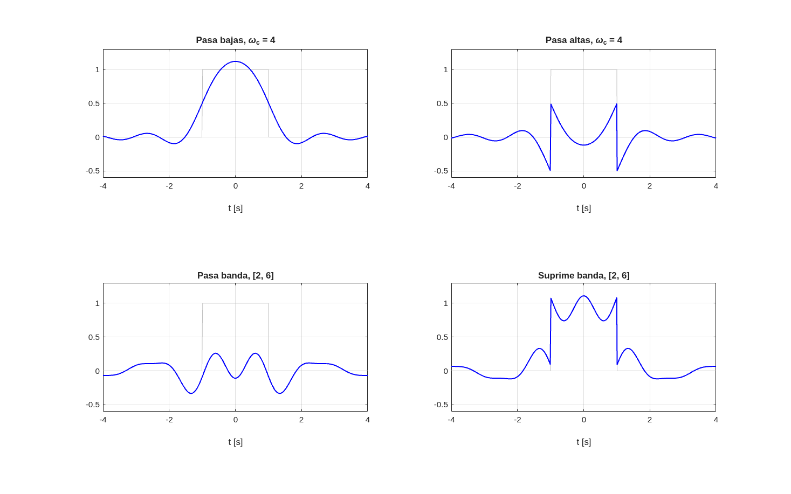
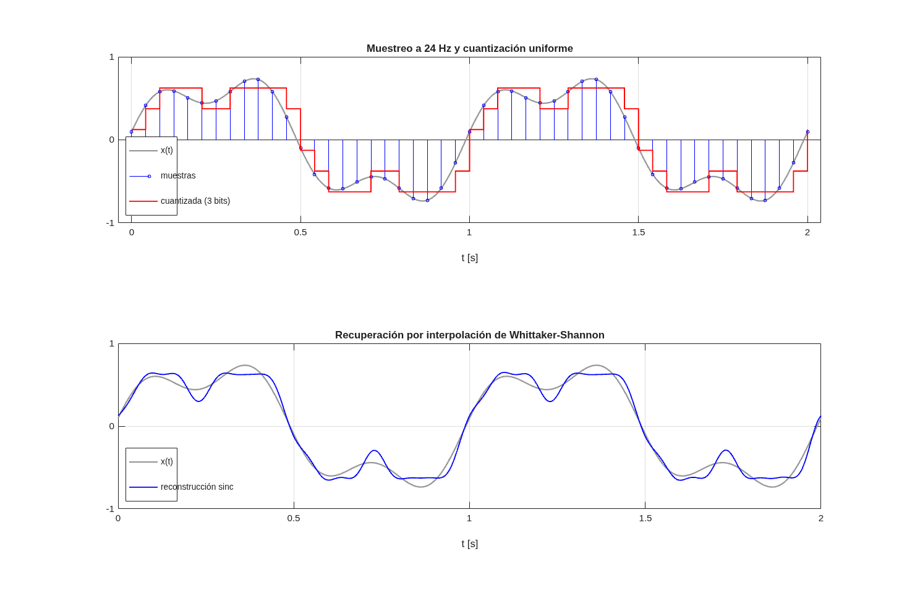
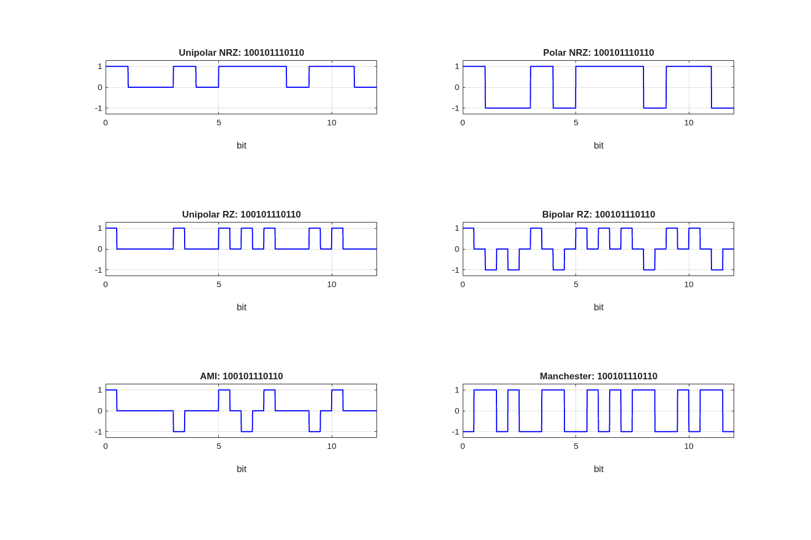

# Laboratorios de Fourier y PCM en MATLAB y GNU Octave

[](https://github.com/KevinAndrey96/matlab-fourier-pcm-signal-processing-labs/actions/workflows/ci.yml)


[](LICENSE)

Dos laboratorios de **teoría de la información y comunicaciones** convertidos en una caja de herramientas probada para MATLAB y GNU Octave:

1. **Fourier y filtros ideales.** Pulso rectangular, su transformada analítica $2a\,\mathrm{Sa}(\omega a)$, la aproximación con FFT escalada y los cuatro filtros ideales (pasa bajas, pasa altas, pasa banda y suprime banda).
2. **Modulación por codificación de pulsos (PCM).** Muestreo sobre la tasa de Nyquist, cuantización uniforme, codificación binaria, seis códigos de línea y recuperación por interpolación de Whittaker-Shannon, con la relación señal a ruido de cuantización medida frente a la teórica.

## Contenido

- [Laboratorio 1: Fourier y filtros ideales](#laboratorio-1-fourier-y-filtros-ideales)
- [Laboratorio 2: PCM](#laboratorio-2-pcm)
- [Funciones](#funciones)
- [Ejecución](#ejecución)
- [Pruebas y calidad](#pruebas-y-calidad)
- [Historia del proyecto](#historia-del-proyecto)

## Laboratorio 1: Fourier y filtros ideales

El pulso rectangular de semiancho $a$ y su transformada de Fourier son

$$
x(t) = \begin{cases} 1 & |t| < a \\ 0 & |t| > a \end{cases}
\qquad\Longrightarrow\qquad
X(\omega) = \int_{-\infty}^{\infty} x(t)\,e^{-j\omega t}\,dt = 2a\,\frac{\sin(\omega a)}{\omega a}.
$$

La FFT calcula la transformada discreta $X_k = \sum_n x_n e^{-j 2\pi k n / N}$. Para aproximar la transformada continua hay que multiplicar por el intervalo de muestreo $\Delta t$, usar el eje de frecuencias $\omega_k = 2\pi k / (N \Delta t)$ centrado con `fftshift` y corregir la fase $e^{-j\omega t_0}$ cuando la señal no empieza en $t_0 = 0$. Con 4000 muestras la diferencia máxima entre ambas curvas es $2.4 \times 10^{-4}$:



Un filtro ideal multiplica el espectro por una máscara de unos y ceros; la salida en el tiempo se obtiene con la FFT inversa. El pasa bajas conserva el 91.3 % de la energía del pulso y muestra el fenómeno de Gibbs en los bordes (sobreimpulso cercano al 9 %), el pasa altas conserva solo las transiciones y los filtros de banda se reparten la energía de forma complementaria:



## Laboratorio 2: PCM

La señal $x(t) = 0.7\sin(2\pi t) + 0.25\sin(6\pi t + 0.4)$ tiene frecuencia máxima $f_m = 3$ Hz. Se muestrea a $f_s = 24$ Hz, por encima de la tasa de Nyquist $2 f_m = 6$ Hz, y pasa por:

1. **Cuantización uniforme de media huella** con $L = 2^n$ niveles sobre $[-1, 1]$: paso $\Delta = 2/L$, cada muestra va al centro de su celda y el error queda acotado por $\Delta/2$.
2. **Codificación PCM** de cada nivel en $n$ bits, el más significativo primero. Con $n = 3$, 49 muestras producen 147 bits a 72 bit/s.
3. **Códigos de línea** para transmitir los bits en banda base.
4. **Recuperación** con la interpolación de Whittaker-Shannon

$$
\hat{x}(t) = \sum_n x_q[n]\,\mathrm{sinc}\!\left(\frac{t - nT_s}{T_s}\right), \qquad \mathrm{sinc}(u) = \frac{\sin(\pi u)}{\pi u}.
$$

La relación señal a ruido de cuantización de un seno a plena escala sigue la regla $\mathrm{SQNR} \approx 6.02\,n + 1.76$ dB: cada bit adicional aporta unos 6 dB. Las pruebas lo verifican con 6, 8 y 12 bits.



| Código | Regla |
| :--- | :--- |
| Unipolar NRZ | 1 se envía como $+1$ todo el bit, 0 como $0$. |
| Polar NRZ | 1 como $+1$, 0 como $-1$. |
| Unipolar RZ | 1 como $+1$ durante medio bit y luego $0$. |
| Bipolar RZ | 1 como $+1$ y 0 como $-1$, ambos durante medio bit. |
| AMI | 0 como $0$; los unos alternan $+1$ y $-1$, lo que elimina la componente continua. |
| Manchester (IEEE 802.3) | 1 como transición de bajo a alto y 0 de alto a bajo: siempre hay una transición por bit para recuperar el reloj. |



## Funciones

| Función | Descripción |
| :--- | :--- |
| `rect_pulse(t, a)` | Pulso rectangular con valor $1/2$ en los bordes. |
| `rect_pulse_spectrum(omega, a)` | Transformada analítica $2a\,\mathrm{Sa}(\omega a)$. |
| `fourier_spectrum(x, t)` | Transformada continua aproximada con FFT, escalada y con fase corregida. |
| `ideal_filter_mask(omega, tipo, corte)` | Respuesta de los filtros `lowpass`, `highpass`, `bandpass` y `bandstop`. |
| `apply_ideal_filter(x, t, tipo, corte)` | Filtrado en frecuencia y regreso al tiempo. |
| `uniform_quantizer(x, xmax, bits)` | Valores cuantizados e índices de nivel. |
| `pcm_encode(niveles, bits)` / `pcm_decode(bits, n)` | Codificación y decodificación PCM. |
| `line_code(bits, esquema, muestras_por_bit, tasa)` | Forma de onda de los seis códigos de línea. |
| `sinc_reconstruct(muestras, tiempos, t)` | Interpolación de Whittaker-Shannon. |
| `quantization_snr(x, xq, bits)` | SQNR medida y teórica en dB. |

## Ejecución

```bash
cd examples
octave-cli --eval "lab1_fourier_filters(); lab2_pcm_pipeline()"
matlab -batch "lab1_fourier_filters('../figures'); lab2_pcm_pipeline('../figures')"
```

Sin argumentos los laboratorios muestran las figuras; con una carpeta las guardan como PNG. Las figuras de este README las genera el job de MATLAB del pipeline.

## Pruebas y calidad

```bash
octave-cli --eval "cd tests; run_tests"
matlab -batch "cd tests; run_tests"
```

19 pruebas cubren la transformada por FFT frente a la analítica, el teorema de desplazamiento, las cuatro máscaras, el sobreimpulso de Gibbs, la complementariedad de los filtros, el error y la saturación del cuantizador, la regla de 6 dB por bit, la ida y vuelta de PCM, cada código de línea, la ausencia de componente continua en AMI y Manchester y la reconstrucción sinc. El pipeline de GitHub Actions ejecuta MISS_HIT, las pruebas y los laboratorios en el contenedor oficial de GNU Octave 11 y en MATLAB.

## Historia del proyecto

Los laboratorios se entregaron en 2020 como scripts de Octave con menús interactivos. Al reescribirlos en 2026 se corrigieron varios errores del original: la FFT se graficaba contra el eje del tiempo y sin escalar, el muestreo usaba la frecuencia de muestreo como paso de tiempo, la codificación usaba $\log_2 n$ bits en lugar de $n$ bits por muestra y la fórmula de recuperación tenía los paréntesis del sinc mal ubicados. El código original se conserva en el tag [`v0.1-octave-labs-2020`](https://github.com/KevinAndrey96/matlab-fourier-pcm-signal-processing-labs/tree/v0.1-octave-labs-2020).

## Autor

**Kevin Andrey Herrera Silva** · [GitHub](https://github.com/KevinAndrey96)

## Licencia

Distribuido bajo la [licencia MIT](LICENSE).
