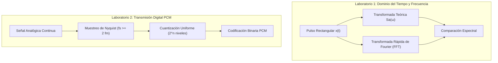

# Laboratorios de Procesamiento de Señales y Teoría de la Información en MATLAB y GNU Octave

[](https://www.mathworks.com/products/matlab.html)
[](LICENSE)

Colección de prácticas y laboratorios computacionales desarrollados en **MATLAB y GNU Octave** para el análisis de señales continuas y discretas, transformadas de Fourier y sistemas de transmisión digital mediante **Modulación por Codificación de Pulsos (PCM)**.

---

## 📡 Contenido de los Laboratorios



---

### 🔬 Laboratorio 1: Pulso Rectangular y Análisis Espectral de Fourier

Aborda la dualidad tiempo-frecuencia para una señal de pulso rectangular de ancho $2a$:

$$x(t) = \text{rect}\left(\frac{t}{2a}\right) = \begin{cases} 1 & |t| < a \\ 0 & |t| \ge a \end{cases}$$

1. **Transformada Continua Teórica de Fourier**:
   Deducción matemática mediante la función de muestreo o sinc no normalizada ($Sa(x) = \frac{\sin x}{x}$):

   $$X(\omega) = \int_{-\infty}^{\infty} x(t) e^{-j\omega t} \, dt = 2a \frac{\sin(\omega a)}{\omega a} = 2a \cdot Sa(\omega a)$$

2. **Transformada Rápida de Fourier Discreta (FFT)**:
   Cálculo computacional mediante el algoritmo `fft()`, aplicando `fftshift()` para centrar el componente continuo (frecuencia cero $\omega = 0$) en el origen del espectro y contrastar directamente la aproximación numérica frente a la solución analítica continua.

---

### 🔬 Laboratorio 2: Modulación por Codificación de Pulsos (PCM)

Simula la cadena completa de conversión analógica a digital (ADC) bajo la arquitectura clásica de **PCM (Pulse Code Modulation)**:

1. **Teorema de Muestreo de Nyquist-Shannon**:
   Para muestrear sin solapamiento espectral (*aliasing*) una señal periódica con frecuencia máxima $f_m$, se establece la frecuencia de muestreo de Nyquist:

   $$f_s \ge 2 f_m$$

2. **Cuantización Uniforme**:
   Discretización del rango de amplitud continua en $L = 2^n$ niveles cuánticos equidistantes con tamaño de escalón $\Delta = \frac{V_{max} - V_{min}}{L}$.
3. **Codificación Binaria**:
   Traducción de cada nivel cuantizado a secuencias de palabras de código binarias de $n = \log_2(L)$ bits por muestra para su transmisión por un canal digital.

---

## 📂 Estructura del Repositorio

```text
teoria-de-la-inf/
├── Lab1/
│   └── Punto2/
│       ├── pulsoRectangular.m   # Definicion vectorial del pulso rectangular temporal
│       └── main.m               # Generacion de graficas (tiempo, Sa(w) analitica y FFT)
└── Lab2/
    ├── punto1.m                 # Script maestro de muestreo, cuantizacion y codificacion PCM
    ├── cuantUniforme.m          # Modulo de cuantizacion uniforme en 2^n niveles
    ├── get_nivel.m              # Mapeo de muestras continuas a indices enteros de nivel
    └── convertir_10.m           # Convertidor de niveles decimales a palabras de codigo binarias
```

---

## 🚀 Requisitos y Ejecución

### Prerrequisitos

- **MATLAB** (R2016a o superior) o **GNU Octave** (4.0 o superior).

### Ejecutar Laboratorio 1 (FFT y Pulso Rectangular)

```bash
cd Lab1/Punto2
octave --persist main.m
```

### Ejecutar Laboratorio 2 (Muestreo y Cuantización PCM)

```bash
cd Lab2
octave --persist punto1.m
```

Al iniciar el script, ingresa la señal matemática a muestrear (por ejemplo: `sin(x)` o `cos(2*x)`). El script generará los gráficos de la señal original, la señal muestreada a tasa de Nyquist, la señal cuantizada y el flujo de bits resultante.

---

## 📄 Licencia

Distribuido bajo la Licencia MIT. Consulta el archivo `LICENSE` para más información.
